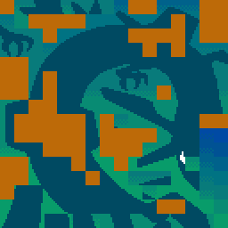

# Emerald public graphics

This page is generated from the repository's verified `graphics/` tree. Japanese and Korean assets are listed before English and other official languages.

## Header

| Preview | File | Language | Size | SHA-256 |
| --- | --- | --- | --- | --- |
|  | [`graphics/header/nintendo-logo-jp.png`](graphics/header/nintendo-logo-jp.png) | Japanese | 416x64 | `f07daf6e489d64b7...` |

## Pokemon

| Preview | File | Language | Size | SHA-256 |
| --- | --- | --- | --- | --- |
|  | [`graphics/pokemon/pikachu-back-rev0-jp.png`](graphics/pokemon/pikachu-back-rev0-jp.png) | Japanese | 128x128 | `d1472dd2f4862fe9...` |
|  | [`graphics/pokemon/pikachu-front-rev0-jp.png`](graphics/pokemon/pikachu-front-rev0-jp.png) | Japanese | 128x128 | `0be25ad9c369dfb5...` |
|  | [`graphics/pokemon/pikachu-back-rev0-en.png`](graphics/pokemon/pikachu-back-rev0-en.png) | English | 128x128 | `d1472dd2f4862fe9...` |
|  | [`graphics/pokemon/pikachu-front-rev0-en.png`](graphics/pokemon/pikachu-front-rev0-en.png) | English | 128x128 | `0be25ad9c369dfb5...` |
|  | [`graphics/pokemon/pikachu-back-rev0-de.png`](graphics/pokemon/pikachu-back-rev0-de.png) | German | 128x128 | `d1472dd2f4862fe9...` |
|  | [`graphics/pokemon/pikachu-front-rev0-de.png`](graphics/pokemon/pikachu-front-rev0-de.png) | German | 128x128 | `0be25ad9c369dfb5...` |
|  | [`graphics/pokemon/pikachu-back-rev0-fr.png`](graphics/pokemon/pikachu-back-rev0-fr.png) | French | 128x128 | `d1472dd2f4862fe9...` |
|  | [`graphics/pokemon/pikachu-front-rev0-fr.png`](graphics/pokemon/pikachu-front-rev0-fr.png) | French | 128x128 | `0be25ad9c369dfb5...` |
|  | [`graphics/pokemon/pikachu-back-rev0-it.png`](graphics/pokemon/pikachu-back-rev0-it.png) | Italian | 128x128 | `d1472dd2f4862fe9...` |
|  | [`graphics/pokemon/pikachu-front-rev0-it.png`](graphics/pokemon/pikachu-front-rev0-it.png) | Italian | 128x128 | `0be25ad9c369dfb5...` |
|  | [`graphics/pokemon/pikachu-back-rev0-es.png`](graphics/pokemon/pikachu-back-rev0-es.png) | Spanish | 128x128 | `d1472dd2f4862fe9...` |
|  | [`graphics/pokemon/pikachu-front-rev0-es.png`](graphics/pokemon/pikachu-front-rev0-es.png) | Spanish | 128x128 | `0be25ad9c369dfb5...` |

| Palette | Language | Colors | SHA-256 |
| --- | --- | --- | --- |
| [`graphics/pokemon/pikachu-rev0-jp.pal`](graphics/pokemon/pikachu-rev0-jp.pal) | Japanese | 16 | `066a8707fdfbf027...` |
| [`graphics/pokemon/pikachu-rev0-en.pal`](graphics/pokemon/pikachu-rev0-en.pal) | English | 16 | `066a8707fdfbf027...` |
| [`graphics/pokemon/pikachu-rev0-de.pal`](graphics/pokemon/pikachu-rev0-de.pal) | German | 16 | `066a8707fdfbf027...` |
| [`graphics/pokemon/pikachu-rev0-fr.pal`](graphics/pokemon/pikachu-rev0-fr.pal) | French | 16 | `066a8707fdfbf027...` |
| [`graphics/pokemon/pikachu-rev0-it.pal`](graphics/pokemon/pikachu-rev0-it.pal) | Italian | 16 | `066a8707fdfbf027...` |
| [`graphics/pokemon/pikachu-rev0-es.pal`](graphics/pokemon/pikachu-rev0-es.pal) | Spanish | 16 | `066a8707fdfbf027...` |

## Title

| Preview | File | Language | Size | SHA-256 |
| --- | --- | --- | --- | --- |
|  | [`graphics/title/rayquaza-en.png`](graphics/title/rayquaza-en.png) | English | 256x256 | `7cd0a76cf0d0ac02...` |
|  | [`graphics/title/rayquaza-de.png`](graphics/title/rayquaza-de.png) | German | 256x256 | `7cd0a76cf0d0ac02...` |
|  | [`graphics/title/rayquaza-fr.png`](graphics/title/rayquaza-fr.png) | French | 256x256 | `7cd0a76cf0d0ac02...` |
|  | [`graphics/title/rayquaza-it.png`](graphics/title/rayquaza-it.png) | Italian | 256x256 | `7cd0a76cf0d0ac02...` |
|  | [`graphics/title/rayquaza-es.png`](graphics/title/rayquaza-es.png) | Spanish | 256x256 | `7cd0a76cf0d0ac02...` |
|  | [`graphics/title/rayquaza-and-clouds-swatch.png`](graphics/title/rayquaza-and-clouds-swatch.png) | Unspecified | 256x16 | `0bceb8eb914a4199...` |
|  | [`graphics/title/rayquaza.png`](graphics/title/rayquaza.png) | Unspecified | 256x256 | `7cd0a76cf0d0ac02...` |

| Palette | Language | Colors | SHA-256 |
| --- | --- | --- | --- |
| [`graphics/title/rayquaza-and-clouds.pal`](graphics/title/rayquaza-and-clouds.pal) | Unspecified | 16 | `f5476579102419d5...` |

Every entry is tied to at least one existing analysis or manifest record. Full hashes and provenance links are in `analysis/public-graphics-catalog.json`.
